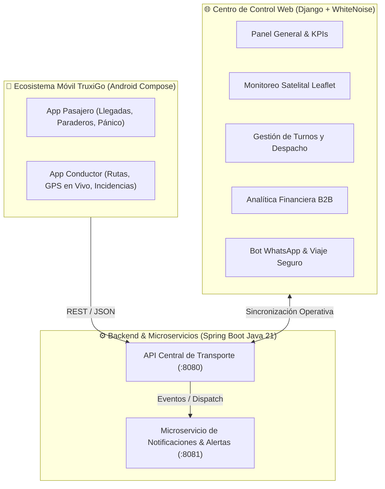

# 🚌 Sistema Integrado de Control de Flota y Operaciones · Nuevo California S.A.

[](https://www.python.org/)
[](https://www.djangoproject.com/)
[](https://gestion-transporte-california.onrender.com)
[-6DB33F.svg)](https://spring.io/)
[](https://developer.android.com/)
[](#)

> **Plataforma Integral de Transporte Urbano** diseñada para la gestión operativa en tiempo real, auditoría financiera, monitoreo satelital GPS y seguridad del pasajero en la ciudad de Trujillo, Perú.

🌐 **Servicio Web en Producción:** [https://gestion-transporte-california.onrender.com](https://gestion-transporte-california.onrender.com)

---

## 🏛️ Arquitectura del Sistema



---

## 🚀 Módulos Principales de la Plataforma Web

1. **Centro de Control & Monitoreo en Vivo:**
   - Visualización interactiva de flota en servicio con capas de Google Maps, Satélite y OpenStreetMap.
   - Panel de pasajeros en espera por paradero y detalle en tiempo real de cada unidad.
2. **Gestión de Despacho y Turnos:**
   - Control de salidas, llegadas y registro automático de pasos por paraderos de control.
   - Restricción de despacho ante vencimiento de SOAT, revisión técnica o brevete.
3. **Analítica de Rentabilidad B2B y Auditoría:**
   - Cálculo automático de Recaudación Bruta Diaria y Mensual.
   - Monitoreo de consumo de combustible auditado mediante distancias GPS vs. ralentí.
   - Detección de pérdida de demanda por demoras de frecuencia (> 10 minutos).
4. **Innovación & Seguridad Ciudadana:**
   - **Viaje Seguro:** Enlace y código de viaje verificable para familiares en tiempo real.
   - **Bot de WhatsApp:** Consulta instantánea de microbuses más cercanos mediante geolocalización.
   - **Alertas Sonoras Profesionales:** Sintetizadas con Web Audio API para notificación acústica inmediata de incidencias críticas.
5. **Diseño 100% Adaptativo (Responsive):**
   - Menú lateral táctil tipo *drawer offcanvas* para dispositivos móviles.
   - Rejilla fluida de indicadores y mapas GPS optimizados para teléfonos celulares y tablets.

---

## 📜 Historial de Cambios y Versiones
Para consultar la evolución detallada, características añadidas y correcciones a través del tiempo, consulta el archivo:  
👉 **[CHANGELOG.md](CHANGELOG.md)**

---

## 💻 Puesta en Marcha Local

### Requisitos Previos:
- Python 3.10 o superior
- Git

### Pasos de Instalación:
```powershell
# 1. Clonar el repositorio
git clone https://github.com/XsosaM/transporte-california-web.git
cd transporte-california-web

# 2. Crear y activar entorno virtual
python -m venv .venv
.\.venv\Scripts\Activate.ps1

# 3. Instalar dependencias
pip install -r requirements.txt

# 4. Ejecutar migraciones
python manage.py migrate

# 5. Iniciar servidor de desarrollo
python manage.py runserver 0.0.0.0:8000
```
Accede desde tu navegador en `http://127.0.0.1:8000/`.

---

## 👥 Equipo de Desarrollo y Colaboradores
Proyecto desarrollado para la gestión de flota y modernización del transporte público de Trujillo:
- **Xander Sosa** ([@XsosaM](https://github.com/XsosaM)) — Arquitectura, Cloud Deployment, UI Responsive y Android Integration.
- **Royer Muñoz** ([@REMXX-02](https://github.com/REMXX-02)) — Modelado de datos inicial y estructura base de gestión.
